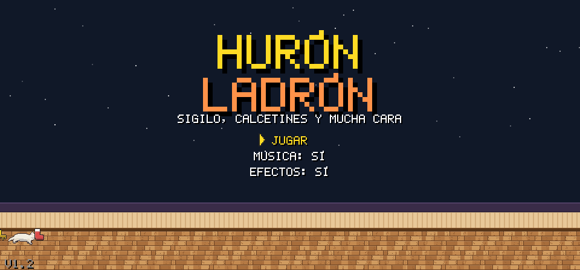
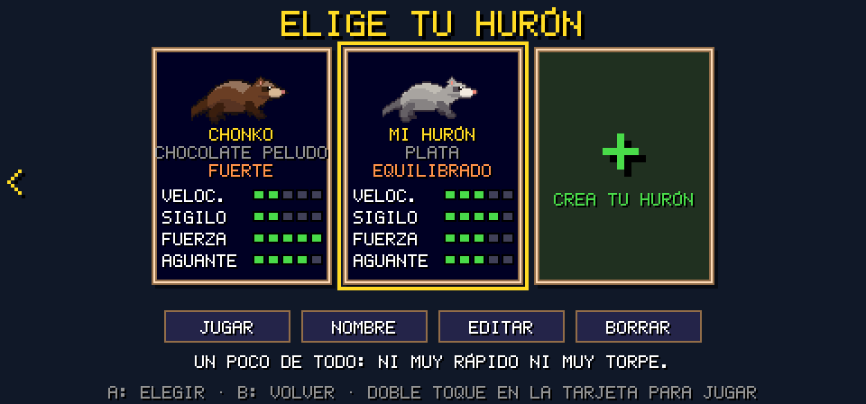
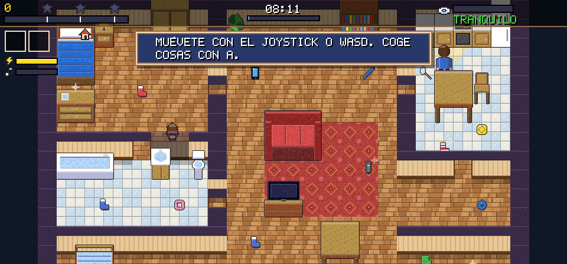
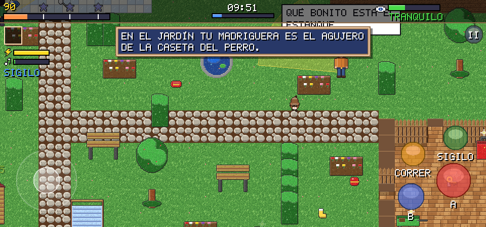
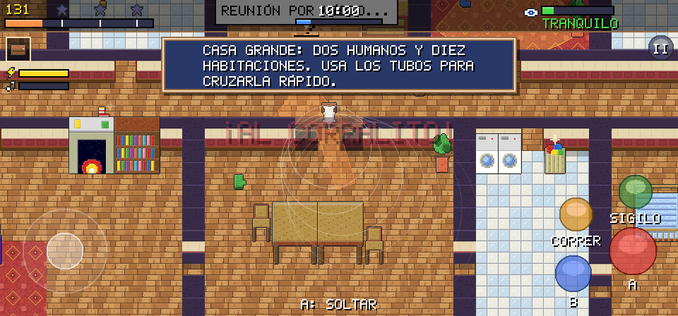
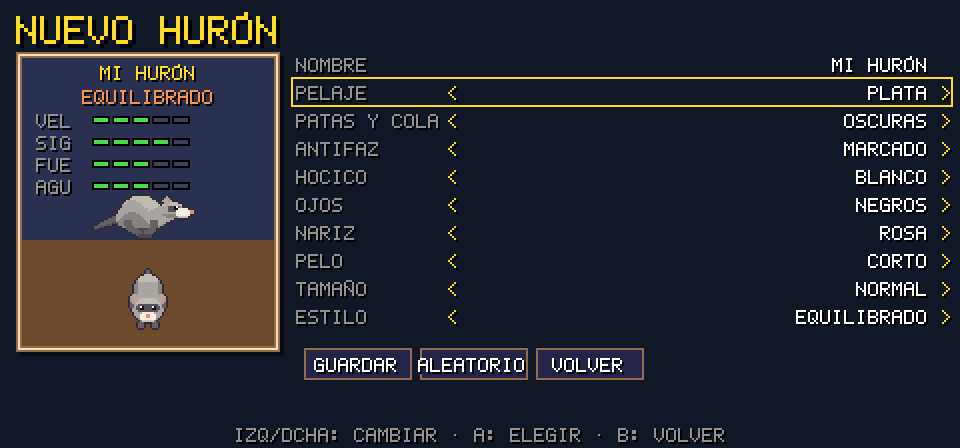
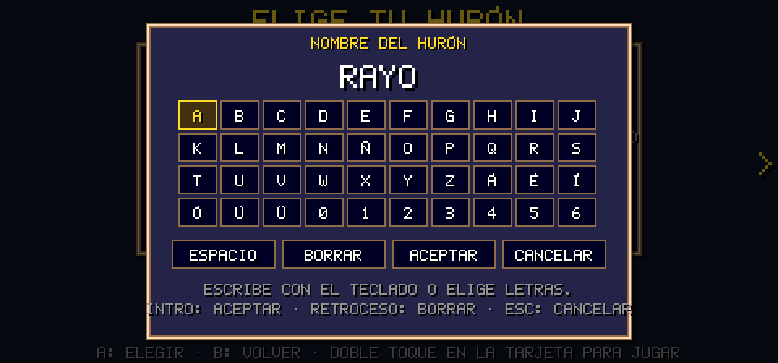
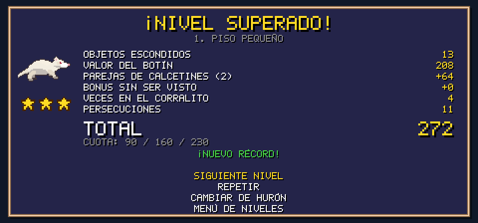

# Hurón Ladrón

Juego 2D de sigilo para Android con estética de 16 bits (tipo Mega Drive). **Versión 1.2.** Eres un hurón que roba
calcetines, llaves, mandos y todo lo que pilla por la casa, y lo esconde en su madriguera o en el
sofá antes de que el dueño le pille. Llena la cuota de cada nivel para conseguir hasta 3 estrellas.


| | |
|---|---|
|  |  |
|  |  |
|  |  |
|  |  |

Todo está generado por el código de este directorio: pixel art (personajes, objetos, muebles,
suelos, fuente bitmap e icono), efectos de sonido y música chiptune (Web Audio). No hay ni un
asset externo.

## Instalar en el móvil

| Versión | APK | Novedades |
|---|---|---|
| **1.2** | [`release/huron-ladron-1.2.apk`](release/huron-ladron-1.2.apk) (≈ 390 KB) | Gráficos en alta resolución, niveles 4 y 5, nombres editables y editor de hurones |
| 0.1 | [`release/huron-ladron.apk`](release/huron-ladron.apk) | Primera versión jugable (3 niveles), se conserva como base |

Ambas están firmadas con la misma clave y la 1.2 tiene un código de versión mayor, así que se instala
encima de la 0.1 conservando el progreso. Requieren Android 7.0 o superior.

1. Copia el APK al móvil y ábrelo (Android pedirá permitir «instalar apps de origen desconocido»).
2. O por USB: `adb install -r release/huron-ladron-1.2.apk`

Se juega en horizontal y a pantalla completa. El botón «atrás» pausa la partida.

## Cómo se juega

- **Roba**: acércate a un objeto y pulsa **A**. Los muebles con un brillo (cómoda, mesilla, cesta,
  abrigo, bolso, zapatero) esconden cosas: quédate quieto junto a ellos y pulsa **A** para rebuscar
  (hace ruido). Con la boca llena, **A** junto a otro objeto lo cambia por el que llevas.
- **Esconde**: lleva el botín a la **madriguera** (bajo la cama, marcada con una casita) o al
  **sofá** (vale **x1.5**, pero si el dueño sospecha, revisará los cojines y recuperará lo que haya).
  Solo cuenta lo escondido.
- **Cuota**: la barra superior se llena con el valor de lo escondido. Hay 3 umbrales (★ ★★ ★★★).
  Con la primera estrella puedes **dormir en la madriguera** para terminar el día, o seguir robando
  hasta que caiga la noche (reloj de 08:00 a 20:00).
- **Parejas**: dos calcetines del mismo color escondidos valen el **triple**.
- **Potenciadores** (brillan): si los usas con **B** pierdes sus puntos.
  - Calcetín de lana: te deslizas a toda velocidad (más lejos sobre azulejo).
  - Llaves: las lanzas y el tintineo atrae al dueño hacia donde caen.
  - Mando: enciende la tele y el dueño se sienta a verla unos segundos.
  - Golosina: subidón de velocidad y sigilo al cogerla.
- **Ruido**: correr, rebuscar y cargar cosas pesadas o ruidosas hace ruido (ondas en pantalla y barra
  del HUD). La alfombra amortigua los pasos; el azulejo los amplifica. En **sigilo** apenas se oye.
- **Escóndete** bajo mesas, camas y escritorios: ahí no te ven.
- **Si te pillan**, vas al corralito: pierdes lo que llevabas en la boca y tiempo del día. Machaca **A**
  para escapar antes.

### El dueño

Sigue una rutina (cocinar, ver la tele, lavarse los dientes, hablar por teléfono...). Tiene un cono
de visión visible en el suelo y oye el ruido que haces. Estados: tranquilo → sospecha (**?**, va a
mirar) → buscando → persecución (**!**). Una **sospecha global** sube cuando oye ruidos, te ve, te
persigue o echa en falta cosas (*«¿Dónde está mi móvil?»*). Con la sospecha alta intenta ponértelo
más difícil:

- **Alerta**: cierra puertas (las abre al pasar él), patrulla más rápido, espera menos y revisa el sofá.
- **Paranoia**: rutas nuevas, más alcance de vista y vigila los objetos más valiosos que quedan.
- Recoge lo que dejes tirado y lo devuelve a su sitio.

### Hurones

Los nombres de los tres hurones se pueden cambiar (botón **NOMBRE** en la selección) con un teclado en
pantalla que también acepta el teclado físico. Sus diseños originales se mantienen.

Con la tarjeta **CREA TU HURÓN** abres el **editor**: pelaje (albino, champán, canela, sable, chocolate,
negro, plata, rojizo), patas y cola, antifaz, hocico, ojos, nariz, pelo corto o peludo, tamaño y estilo
de juego (equilibrado, rápido, sigiloso o fuerte). Se pueden guardar hasta 6, editarlos y borrarlos.

| | Sardi | Pepis | Chonko |
|---|---|---|---|
| Pelaje | Blanco | Sable marrón | Chocolate, más peludo |
| Estilo | Rápido | Sigiloso | Fuerte |
| Ventaja | Mayor velocidad | Hace un 40 % menos de ruido | Lleva 2 objetos pequeños o 1 grande casi sin frenarse |
| Pega | Menos aguante corriendo | Algo más lento | Lento y más ruidoso |

### Niveles

1. **Piso pequeño** (tutorial): carteles que explican cada mecánica. Un dueño despistado.
2. **Día de colada**: muchos calcetines para hacer parejas; la cesta de la ropa va y viene entre el
   lavadero y el dormitorio, y lo que sueltes en el lavadero acaba **en la lavadora** (perdido).
   Aparecen las llaves.
3. **Visita en casa**: dueño + invitada con rutas distintas. El bolso y el abrigo de la invitada
   esconden lo más valioso (cartera, móvil, gafas de sol).

4. **El jardín** (exterior): césped que amortigua los pasos, terraza, estanque, setos, flores y bancos
   donde esconderse, tendedero con calcetines y caseta de herramientas. La madriguera es el agujero de
   la caseta del perro. El jardinero hace barbacoa y su pareja toma el sol.
5. **La casa grande**: diez estancias (dormitorio, baño, despacho, cuarto infantil, cocina, salón con
   chimenea y piano, comedor, lavadero, recibidor) unidas por un pasillo largo, dos tubos para cruzarla y
   dos humanos.

Cada nivel se desbloquea al superar el anterior. El progreso y los récords se guardan.

## Controles

| Acción | Táctil | Teclado | Mando |
|---|---|---|---|
| Moverse | Joystick (mitad izquierda) | Flechas / WASD | Stick / cruceta |
| Coger, esconder, rebuscar | **A** | Z, Espacio, Intro, E | A |
| Usar potenciador | **B** | X, Q | B / X |
| Correr (mantener) | CORRER | Shift | RT / RB |
| Sigilo | SIGILO (activa/desactiva) | C o Ctrl (mantener) | LT / LB |
| Pausa | II | Esc, P | Start |

## Desarrollo

Requisitos: Node 18+ (para el APK además Java 17+ y Python 3 con Pillow).

```bash
npm install
npm run dev        # http://localhost:8080 con recarga automática
npm test           # tests de la simulación y de los datos de los niveles (node:test)
npm run test:e2e   # prueba en Chromium (Playwright): menús, teclado, táctil y los 3 niveles con el bot
npm run balance    # el bot juega los 3 niveles con los 3 hurones y muestra puntos/estrellas
npm run apk        # compila dist/ y genera release/huron-ladron-1.2.apk
```

Modo de pruebas en el navegador: `index.html?bot=1&speed=4` hace que el bot juegue solo y acelera la
simulación.

### Estructura

```
src/
  sim/        Simulación pura (sin Phaser): rejilla, colisiones, A*, visión, ruido, IA del dueño,
              puntuación y el bot. Se usa en el juego, en los tests y en el balance.
  data/       Objetos, hurones y niveles (mapas tallados por habitaciones + muebles + rutinas).
  gfx/        Pixel art generado por código: hurones con esqueleto animado (ferret.js), humanos HD
              (humans.js), suelos y paredes HD (floors.js), muebles y objetos con biselado y
              texturas (hd.js), fuente 5x7 con tildes.
  audio/      Efectos y música (3 canales: pulso, triángulo y ruido) con Web Audio.
  scenes/     Boot, Title, Select, Levels, Game, Hud, Pause, Results.
  ui/         Texto bitmap, paneles, menús navegables y controles (teclado, mando, táctil).
android/      Contenedor WebView y la cadena de empaquetado del APK.
tests/        Tests unitarios y prueba e2e.
tools/        Build, servidor de desarrollo, balance y previsualización del arte.
```

Para añadir un nivel, crea `src/data/levels/levelN.js` siguiendo los existentes (habitaciones con
`carve`, muebles, objetos, rutinas del dueño por nivel de sospecha) y añádelo a `index.js`.
`npm test` comprueba que todo es alcanzable y que la cuota máxima es posible.

### Cómo se genera el APK sin Android SDK

El entorno donde se creó no tenía acceso al SDK de Google, así que el APK se monta a mano con
herramientas descargadas de Maven Central (con comprobación de SHA-1):

1. `javac` compila `MainActivity` (un WebView a pantalla completa e inmersivo) contra `android.jar`
   (API 16; lo posterior se usa por reflexión o constantes).
2. `dx` lo convierte a `classes.dex`.
3. `android/apkpack.py` escribe el `AndroidManifest.xml` binario y un `resources.arsc` mínimo con el
   icono, y monta el zip (con `resources.arsc` sin comprimir y alineado a 4 bytes).
4. `apksig` firma con el esquema v2 y verifica la firma; `android/check_apk.py` revisa la estructura
   (y el manifiesto con androguard si está instalado).

El juego va en `assets/` como un único script clásico, para que funcione desde `file://` dentro del
WebView. La clave de firma es de depuración y se genera en `android/debug.p12` (no se sube al repo):
si la regeneras, desinstala la app antes de instalar una versión nueva.

### Decisiones respecto al encargo original

- **esbuild** en lugar de Vite: genera un único script que el WebView carga desde `file://` sin
  problemas de módulos ES. `npm run dev` ofrece igualmente recarga automática.
- **Cámara cenital 3/4** en lugar de isométrica: es lo que mejor funciona en 2D pixel art. Paredes y
  muebles altos se vuelven semitransparentes cuando el hurón pasa por detrás.
- La Mega Drive es de **16 bits**: la paleta está cuantizada a 3 bits por canal, como su VDP.
- Resolución interna de 448 px de alto (el ancho, 640–960, se adapta a la pantalla): el mundo se dibuja
  a doble resolución para tener más detalle, y la interfaz usa zoom 2 para mantener su aspecto retro.

### Novedades de la 1.2

- **Hurones nuevos**: se dibujan con un esqueleto (columna que se arquea y se estira en el galope, patas
  articuladas, hocico claro y orejas rosas) inspirado en la animación de referencia. Galope de 6
  fotogramas, sigilo agachado, reposo y de pie sobre las patas traseras (en el corralito o al
  quedarse quieto).
- **Casa y humanos más detallados**: suelos con veta y brillo, papel pintado por nivel, muebles con
  biselado y texturas, y humanos con ojos, cejas, pelo con brillo y ropa con sombras.
- **Niveles 4 (jardín) y 5 (casa grande)**, con muebles y objetos nuevos (paleta de jardín, frisbee,
  pinzas de barbacoa).
- **Nombres editables y editor de hurones.**
